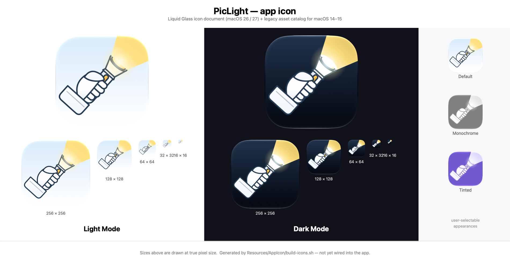

# PicLight — app icon (staging, archived)

> **Archived 2026-09-27.** This reference-style pack (glass tile, gradient artwork) was superseded
> by the native v4 design. The icon that ships is `Resources/AppIcon/PicLight.icon` +
> `Resources/AppIcon/PicLight.icns`; `scripts/build-release.sh` compiles it and
> `scripts/verify-release.sh` checks it. The [Integration](#integration) section below is kept as
> the record of how the wiring was designed — the patch itself is applied, from the v4 files, in
> `scripts/build-release.sh`. The old pack was moved from `Resources/AppIcon/` to here so that
> `Resources/` holds only what the app ships.

Generated app-icon assets for PicLight, authored from the reference design (a gloved fist holding
a flashlight, warm beam to the upper right, on a rounded-square glass tile).



---

## What is here

| Path | What it is |
| --- | --- |
| `AppIcon.icon/` | **Icon Composer document** — the Liquid Glass icon for macOS 26/27. `icon.json` + two SVG layers in `Assets/`. |
| `AppIcon.appiconset/` | Asset-catalog app icon (10 renditions) — the macOS 14–15 back-compat path. |
| `PicLight.icns` | Loose bundle icon for `Info.plist` `CFBundleIconFile`, valid `icns`/`ic12` with all 10 sizes. |
| `PicLight.iconset/` | `iconutil` source the `.icns` is packed from. |
| `preview/` | Review sheets (see below). |
| `src/make_art.py` | Vector artwork generator — the single source of truth for the drawing. |
| `src/icon.json` | The Icon Composer document manifest, copied verbatim into `AppIcon.icon/`. |
| `tools/*.swift` | Small helpers (grid compositor, contact sheets, pixel statistics). |
| `build-icons.sh` | Rebuilds everything above from `src/`. |
| `build/` | Intermediates, including a **real `Assets.car` compiled by `actool`**. |

### Preview sheets

| Sheet | Shows |
| --- | --- |
| `preview/00-overview.png` | One-page overview: light panel, dark panel, Default/Monochrome/Tinted column. |
| `preview/01-size-ladder.png` | Light appearance at true pixel sizes, 512 → 16. |
| `preview/02-size-ladder-dark.png` | Dark appearance at true pixel sizes. |
| `preview/03-renditions.png` | All six renditions `ictool` can produce. |
| `preview/04-design-generation.png` | Same document rendered with `--design-generation 26` vs `27`. |
| `preview/05-legacy-iconset.png` | The legacy grid used for `PicLight.icns`. |

---

## Compatibility

| Target | Mechanism | Status |
| --- | --- | --- |
| **macOS 26 / 27** | `AppIcon.icon` → `actool` → `Assets.car` (Liquid Glass icon stack) | Built and verified — see below |
| **macOS 14 – 15** | `AppIcon.appiconset` / `PicLight.icns` on the classic 824/1024 grid | Built and verified |
| **Icon Composer 1.x** (macOS 26) | Document opens — it uses no version-gated keys | by construction |
| **Icon Composer 2.0** (macOS 27) | Document opens; 2.0 rendering adds its own material refinements | by construction |
| **iOS / watchOS / visionOS** | — | not targeted (`supported-platforms.squares = ["macOS"]`) |

### Why the document is deliberately "1.x-shaped"

The macOS 27 renderer adds `refractivity` and `specular-highlight-placement`, but those keys are
gated behind a top-level `"features"` array, and **Icon Composer 1.x refuses to open a document
that declares a feature it does not know** ("This document uses features from a newer version of
Icon Composer"). Declaring them would therefore trade macOS 26 support for a slightly richer
macOS 27 material. The document stays on 1.x-shaped keys so one file works on both, and the OS
applies its own generation-appropriate material — `preview/04-design-generation.png` shows the
same document rendered both ways.

To opt into the 2.0-only material later (dropping Xcode 26 compatibility), add to `src/icon.json`:

```jsonc
"features": ["refractivity", "specular-location"],
"groups": [ { "refractivity": { "enabled": true, "strength": 0.577, "depth": 0.611 },
              "specular-highlight-placement": "outside", /* … */ } ]
```

---

## Integration

Two independent paths. Ship **both**: Apple's own release note says to keep the asset-catalog icon
until the back-deploy issue is resolved, and a `.icon`-only app can trip App Store validation
(ITMS-90236, "does not contain an icon of size 512pt x 512pt @2X").

### A. macOS 26/27 Liquid Glass — `AppIcon.icon`

`actool` compiles the `.icon` and the `.appiconset` into one `Assets.car`. This is exactly what
the build script already does for verification:

```bash
xcrun actool \
  --output-format human-readable-text --notices --warnings --errors \
  --platform macosx --target-device mac --minimum-deployment-target 14.0 \
  --app-icon AppIcon --include-all-app-icons \
  --output-partial-info-plist build/car/partial.plist \
  --compile build/car \
  Resources/AppIcon/AppIcon.appiconset \
  Resources/AppIcon/AppIcon.icon          # must be named to match --app-icon
```

Then in the app bundle:

```
PicLight.app/Contents/Resources/Assets.car
PicLight.app/Contents/Info.plist:  CFBundleIconName = AppIcon
```

Verified contents of the `Assets.car` this produces — note it carries the icon stack *and* the
flattened legacy renditions:

```
AppIcon            11 renditions, incl. AppIcon.iconstack
                     NSAppearanceNameAqua / NSAppearanceNameDarkAqua / ISAppearanceTintable
                     + AppIcon1024x1024_….png, AppIcon256x256_….png, AppIcon16x16_….png, …
AppIcon/Subject     3 renditions (the "Subject" group, Aqua / DarkAqua / Tintable)
AppIcon_Assets/     Color-1…5, Gradient-1…2
```

> A SwiftPM package has no asset-catalog build phase, so for this project the `actool` call has to
> be added to `scripts/build-release.sh` (or the app has to move to an Xcode project). Path B below
> needs no build-system change at all.

### B. macOS 14+ — `PicLight.icns` (no build-system change)

```
PicLight.app/Contents/Resources/PicLight.icns
PicLight.app/Contents/Info.plist:  CFBundleIconFile = PicLight
```

That is a two-line patch to `scripts/build-release.sh`:

```diff
 mkdir -p "$APP/Contents/MacOS" "$APP/Contents/Resources"
 cp "$BIN" "$APP/Contents/MacOS/$APP_NAME"
+cp "$ROOT/Resources/AppIcon/PicLight.icns" "$APP/Contents/Resources/PicLight.icns"
 
 cp "$ROOT/Resources/Assets.xcassets/Contents.json" "$APP/Contents/Resources/Assets.json" 2>/dev/null || true
```

```diff
     <key>CFBundleName</key><string>PicLight</string>
+    <key>CFBundleIconFile</key><string>PicLight</string>
```

On macOS 26/27 the system additionally wraps a legacy `.icns` in its own template — it still gets
the new rounded-square treatment, but from Apple's generic material rather than from this
artwork. That is why path A is worth doing.

---

## Regenerating

```bash
Resources/AppIcon/build-icons.sh
```

Requirements: macOS 26 or later with **Icon Composer** (ships inside Xcode 26+; `ictool` lives at
`/Applications/Xcode.app/Contents/Applications/Icon Composer.app/Contents/Executables/ictool`),
plus the Xcode command line tools. The script compiles its Swift helpers on first run.

To change the drawing, edit `src/make_art.py` (geometry is parameterised — lens position, tilt
angle, barrel radius, finger stack) or `src/icon.json` (tile gradients, glass settings) and re-run.

---

## How this was verified

Everything below was measured on this machine, not assumed.

| Check | Result |
| --- | --- |
| Rendered with `ictool`, the same renderer the OS uses | all 6 renditions × 2 design generations |
| Legacy grid vs shipped system icons | alpha bbox **872/1024 = 0.8516**, identical to Calculator, Preview and Xcode |
| `.icns` round-trip via `iconutil -c iconset` | all 10 sizes present; `icns`/`ic12` container |
| `actool` compile | succeeds; icon stack + legacy renditions both present in `Assets.car` |
| Small sizes | reviewed at true pixel size in `preview/01` and `preview/02` |

### Renderer constraints discovered (they shape the source files)

* **`mix-blend-mode` in SVG is silently ignored** by CoreSVG. Blend modes must be set with
  Icon Composer's own `blend-mode` / `blend-mode-specializations`.
* **Gradients, `clipPath`, `mask`, `opacity` and `feGaussianBlur` do work.**
* **Layer assets must live in `Assets/`** — files next to `icon.json` are ignored and the layer
  renders blank, with no error.
* **`linear-gradient` takes exactly two colours** plus an optional `orientation`; three stops is
  a hard error ("Linear gradients require exactly 2 colors").
* **`color-space-for-untagged-svg-colors` only accepts `display-p3`.** The key is omitted here so
  the sRGB hex values in the artwork render as authored.
* `blend-mode-specializations` works per appearance — this icon blends the beam **additively in
  dark** (a glow) and **normally in light** (where additive blending over a pale tile washes the
  yellow out to white).

### Apple references

* [Creating your app icon using Icon Composer](https://developer.apple.com/documentation/xcode/creating-your-app-icon-using-icon-composer)
* [Configuring your app icon using an asset catalog](https://developer.apple.com/documentation/xcode/configuring-your-app-icon)
* [HIG — App icons](https://developer.apple.com/design/human-interface-guidelines/app-icons)
* [Adopting Liquid Glass](https://developer.apple.com/documentation/technologyoverviews/adopting-liquid-glass)
* WWDC25 220 [Say hello to the new look of app icons](https://developer.apple.com/videos/play/wwdc2025/220/) · WWDC25 361 [Create icons with Icon Composer](https://developer.apple.com/videos/play/wwdc2025/361/) · WWDC26 8012 [Icon Composer group lab](https://developer.apple.com/videos/play/wwdc2026/8012/)
* In-app glass, for reference in the rest of the app: [`NSGlassEffectView`](https://developer.apple.com/documentation/appkit/nsglasseffectview) — `style` is `NSGlassEffectView.Style` (`.clear` / `.regular`); there is no `glassStyle` property, and there is no `NSImage.applicationIcon` (`NSApplication.applicationIconImage` is the unrelated legacy API). There is **no public API to load or tint a `.icon` document at runtime.**

---

## Known limitations

* **The artwork is an original interpretation of the reference, not a pixel copy.** The reference
  is a raster image; this is hand-built vector geometry in the same visual language (thick navy
  outlines, white glove and flashlight, warm beam, pastel glass tile). Edit `src/make_art.py` if
  you want the proportions pushed further.
* The bundled `Assets.car` in `build/` is a verification artifact. Regenerate it after any change.
* `build/` is git-ignored; the committed products are `AppIcon.icon/`, `AppIcon.appiconset/`,
  `PicLight.icns`, `PicLight.iconset/` and `preview/`.
